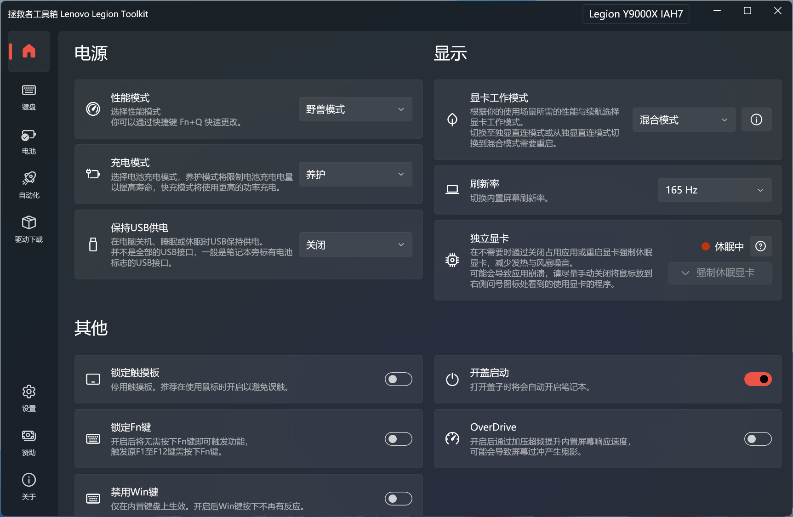

> [!NOTE]
> **关于本仓库 / About this repository**
>
> 本仓库是 [Bartosz Cichecki](https://github.com/BartoszCichecki/LenovoLegionToolkit) 归档的开源项目 LenovoLegionToolkit 的副本，由本人（[Einstein-WSY](https://github.com/Einstein-WSY)）基于原作者已归档的代码自行创建，**仅供个人学习与研究使用**，非官方项目，与原作者及联想（Lenovo）均无隶属关系。
>
> 在原代码基础上做了中文注释、界面汉化、部分模块的调整与缺陷修复，相关改动仅用于学习目的。原项目采用 GPL-3.0 协议，本仓库的延续使用同样遵循该协议；如需使用或分发，请保留原许可与署名。
>
> This repository is a personal copy of the archived open-source project LenovoLegionToolkit by [Bartosz Cichecki](https://github.com/BartoszCichecki/LenovoLegionToolkit), created by [Einstein-WSY](https://github.com/Einstein-WSY) **for personal learning and research purposes only**. It is not an official project and is not affiliated with the original author or Lenovo. Modifications (Chinese comments, localization adjustments, and bug fixes) are for study only. The project remains licensed under GPL-3.0.

# Lenovo Legion Toolkit（个人学习版）

原作者项目地址：https://github.com/BartoszCichecki/LenovoLegionToolkit

本项目为联想拯救者（Legion）系列笔记本的实用工具，可在不依赖 Lenovo Vantage / Legion Zone 的情况下调整电源模式、电池充电阈值、键盘背光等仅 Vantage 提供的功能。原项目不驻留后台服务、占用低、无遥测。

本仓库基于**原作者已归档的代码**创建，仅用于学习研究。在原代码基础上做的主要改动：

- 全项目 500+ 源文件添加简体中文注释
- 界面汉化补全（简体/繁体中文资源完整）
- 移除赞助捐赠、在线更新、保修查询模块及自定义宏功能入口
- 多项性能优化（WMI 缓存复用、启动并行初始化、状态浮窗并行采集等）与 30 余项缺陷修复
- 输出仅保留简繁中文卫星语言，减小安装包体积



## 目录

- [下载安装](#下载安装)
- [兼容性](#兼容性)
- [从源码构建 / Build from Source](#从源码构建--build-from-source)
- [许可证](#许可证)

## 下载安装

`dist/` 目录中提供基于本仓库源码编译好的安装程序：[dist/LenovoLegionToolkitSetup.exe](dist/LenovoLegionToolkitSetup.exe)（v1.0.1）。该版本由本人修改编译，**仅供学习研究使用**。

安装说明：

- 目标机器需要 **.NET 8 Desktop Runtime（Windows x64）**；安装程序在检测到缺失时会自动下载安装
- 若 .NET 安装异常，可手动到 [dotnet.microsoft.com/download/dotnet/8.0](https://dotnet.microsoft.com/download/dotnet/8.0) 下载 ".NET Desktop Runtime" x64 Windows 安装包
- 部分功能依赖驱动，建议确保已安装 **Lenovo Energy Management** 与 **Lenovo Vantage Gaming Feature Driver**
- 使用时建议停用或卸载 Vantage / Hotkeys / Legion Zone，避免功能冲突

> [!WARNING]
> 本工具不含任何担保，使用风险自负。若完全退出程序，部分依赖后台响应的功能（如电源模式与 Windows 电源计划同步）将失效。

## 兼容性

适用于 Lenovo Legion 及类似机型（IdeaPad Gaming、LOQ 及其国行变种），主要支持 2021 款（Gen 6）至 2024 款（Gen 9），部分功能在 2020 款（Gen 5）上也可用。启动时若提示机型不兼容，则该机型不在本项目的支持范围内。

## 从源码构建 / Build from Source

### 环境要求 / Requirements

| 工具 | 版本要求 | 用途 | 获取方式 |
| --- | --- | --- | --- |
| Windows | 10 21H2 及以上 / 11 | 编译与运行环境（本项目依赖 Windows API 与 WMI） | — |
| **.NET SDK** | **8.0.x**（目标框架为 `net8.0-windows`） | 编译必需 | [dotnet.microsoft.com/download/dotnet/8.0](https://dotnet.microsoft.com/download/dotnet/8.0)，或 `winget install Microsoft.DotNet.SDK.8` |
| Visual Studio 2022 | 17.8+，勾选 **.NET 桌面开发** 工作负载 | 可选，用于 IDE 调试运行 | [visualstudio.microsoft.com](https://visualstudio.microsoft.com/)；不装 VS 也可直接用 `dotnet` 命令行 |
| Git | 任意较新版本 | 拉取源码 | [git-scm.com](https://git-scm.com/) |
| Inno Setup 6 | 6.x（可选） | 打包安装程序时才需要 | [jrsoftware.org/isinfo.php](https://jrsoftware.org/isinfo.php) 或 `winget install JRSoftware.InnoSetup` |

验证 .NET SDK 安装：`dotnet --version` 输出 `8.x.x` 即可。

### 编译步骤 / Steps

**1. 克隆仓库**

```sh
git clone https://github.com/Einstein-WSY/LenovoLegionToolkit.git
cd LenovoLegionToolkit
```

**2. 编译整个解决方案（验证环境是否就绪）**

```sh
dotnet build LenovoLegionToolkit.sln -c Release
```

编译成功会输出 `0 个错误`。解决方案包含主程序 WPF、后台库 Lib、自动化 Lib.Automation 等多个工程。

**3. 运行 / 调试**

- 使用 Visual Studio：打开 `LenovoLegionToolkit.sln`，将 `LenovoLegionToolkit.WPF` 设为启动项目，按 F5。
- 仅用命令行：

```sh
dotnet run --project LenovoLegionToolkit.WPF -c Release
```

**4. 发布 exe（单目录输出）**

```sh
dotnet publish LenovoLegionToolkit.WPF -c Release -o build /p:DebugType=None /p:FileVersion=1.0.1 /p:Version=1.0.1
```

输出在 `build/` 目录，双击 `LenovoLegionToolkit.exe` 即可运行（目标机器需安装 .NET 8 Desktop Runtime；不带版本参数也能编译，仅文件属性里的版本号为默认值）。

**5. 打包安装程序（可选）**

安装 [Inno Setup 6](https://jrsoftware.org/isinfo.php) 后执行：

```sh
"C:\Program Files (x86)\Inno Setup 6\ISCC.exe" make_installer.iss /DMyAppVersion=1.0.1
```

输出为 `build_installer/LenovoLegionToolkitSetup.exe`。该脚本会同时打包主程序、命令行工具（CLI）与 SpectrumTester，并在目标机器缺少 .NET 8 时自动下载安装。

### 常见问题

- **编译报错找不到 `net8.0-windows`**：.NET SDK 版本不对，确认安装的是 8.x 而非 6/7/9。
- **编译报错找不到 Windows 类型（WMI / HID 相关）**：必须在 Windows 上编译，Linux/macOS 不支持。
- **`ISCC.exe` 路径带 `/D` 参数报错**：在 Git Bash 中需要加 `MSYS_NO_PATHCONV=1` 前缀，或在 CMD/PowerShell 中执行。
- **运行时提示缺少 .NET**：安装 [.NET 8 Desktop Runtime](https://dotnet.microsoft.com/download/dotnet/8.0) 的 `Desktop Runtime`（Windows x64）。

## 许可证

本项目延续原项目的 [GPL-3.0](LICENSE) 协议。原项目版权归 [Bartosz Cichecki](https://github.com/BartoszCichecki/LenovoLegionToolkit) 所有，本仓库的修改部分同样以 GPL-3.0 开源。仅供学习研究使用，请勿用于商业用途。
